<div align="center">

# nixos

**A flake-based NixOS desktop: Hyprland, a hand-built Quickshell shell, and runtime-switchable themes.**

[](https://nixos.org)
[](https://hypr.land)
[](https://quickshell.org)
[](#themes)

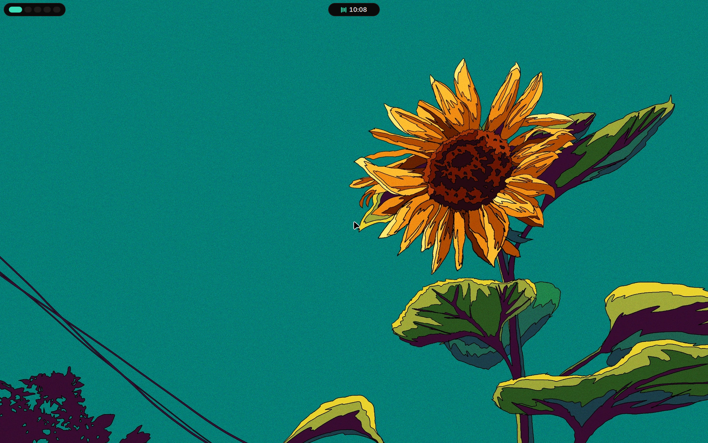

</div>

## Highlights

- **A morphing island shell.** One pill at the top of the screen grows into every surface: launcher, control centre, calendar, wallpaper and theme pickers, Nearby sharing, power profiles, the screen recorder, notifications, OSDs, the session menu and polkit prompts. Written in QML under [`home/quickshell`](home/quickshell).
- **Live theme switching.** `Alt + T` recolours the shell, Hyprland, Ghostty, fish, Helix, GTK and Helium in place, with no rebuild. Ships **Ariadne** (the default), **Rosé Pine** and **ASCII World**.
- **Quick Share and AirDrop** from the Nearby panel (`Alt + N`). Files dragged anywhere in the compositor travel as a card pile drawn by [`dragpile`](pkgs/dragpile), a small Hyprland plugin.
- **Your Android phone on the island.** While it is paired through [KDE Connect](https://kdeconnect.kde.org), a circle with a battery ring appears beside the pill; hover it for notifications, the clipboard, Ring phone and Send files, and a live thumbnail of the screen if you have wireless debugging on.
- **A locked-down session.** greetd autologin goes straight to a Quickshell lock screen that is secured before any desktop helper starts. Secrets are kept in sops-nix, and borg backs up to a NAS every day.
- **Its own tooling.** Custom tools are packaged as a flake overlay in [`pkgs/`](pkgs), with tests next to them.

## Screenshots

<table>
  <tr>
    <td width="50%">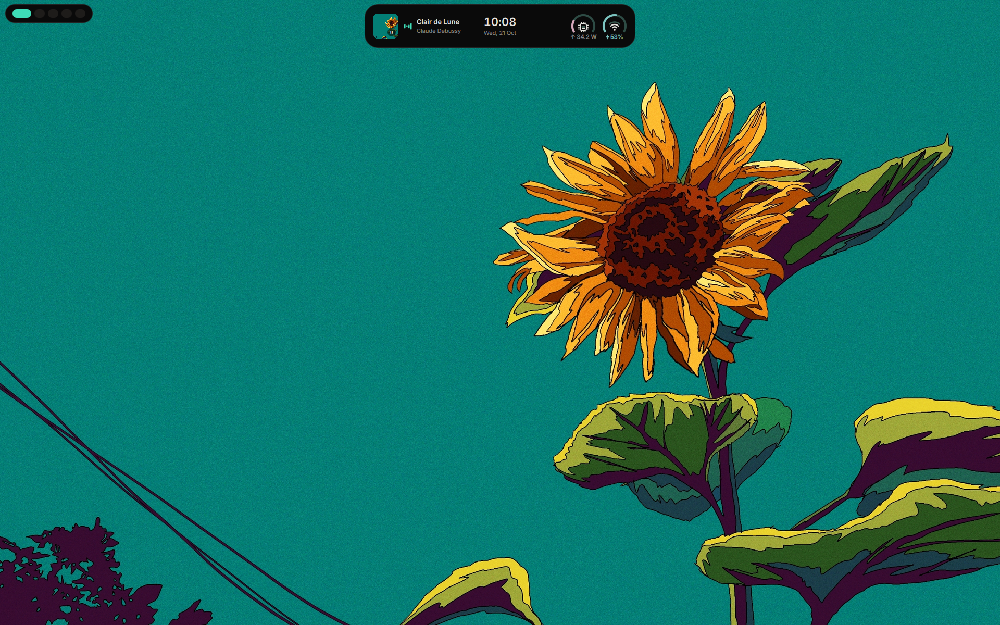<br><sub><b>Island</b>, showing what's playing, the week ahead and system gauges</sub></td>
    <td width="50%">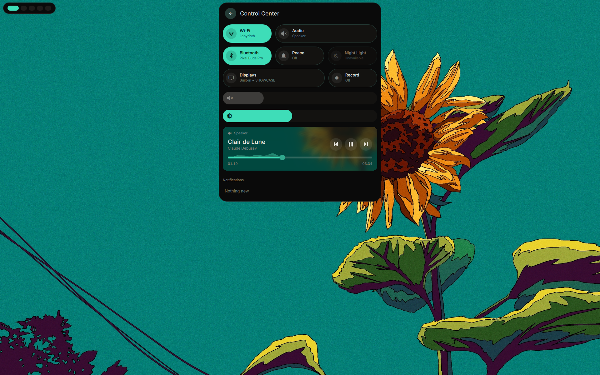<br><sub><b>Control centre</b> (<code>Alt + A</code>)</sub></td>
  </tr>
  <tr>
    <td>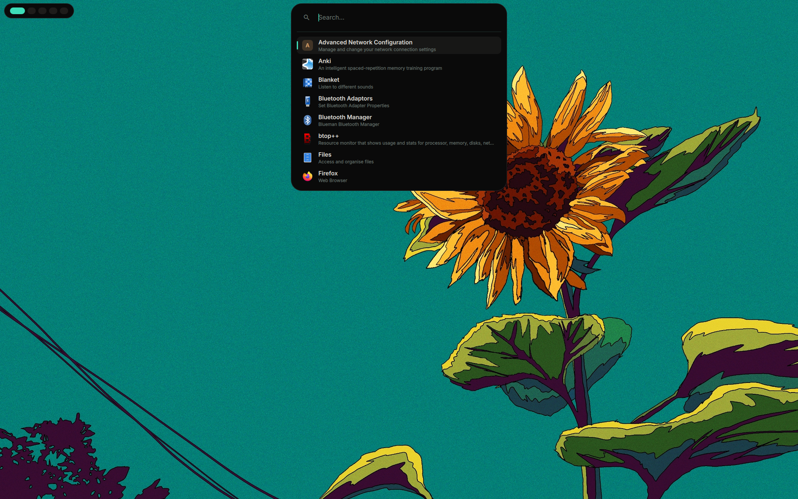<br><sub><b>Launcher</b> (<code>Super + Space</code>)</sub></td>
    <td>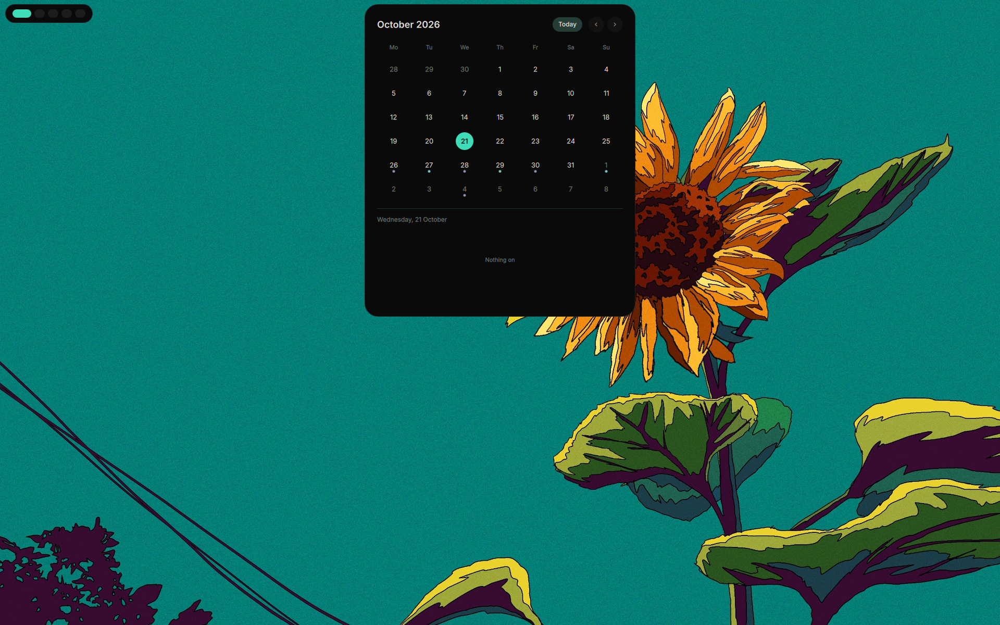<br><sub><b>Calendar</b>, from Google Calendar via iCal (<code>Alt + C</code>)</sub></td>
  </tr>
  <tr>
    <td>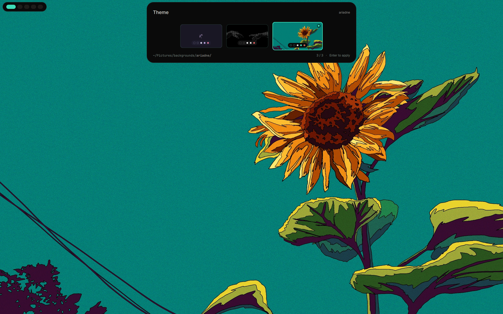<br><sub><b>Theme picker</b> (<code>Alt + T</code>)</sub></td>
    <td>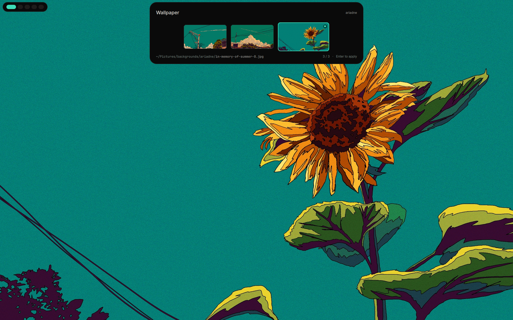<br><sub><b>Wallpaper picker</b> (<code>Ctrl + Super + Space</code>)</sub></td>
  </tr>
  <tr>
    <td>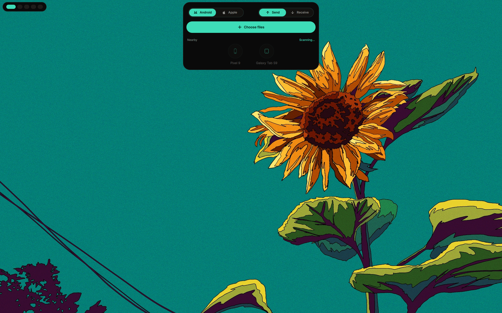<br><sub><b>Nearby</b>: Quick Share and AirDrop (<code>Alt + N</code>)</sub></td>
    <td>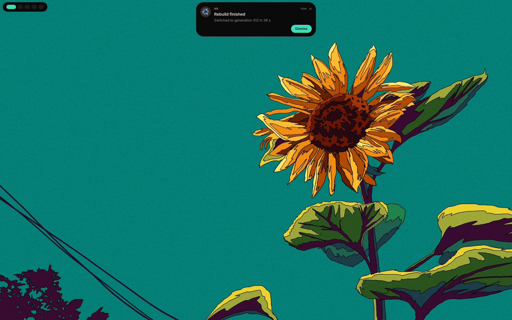<br><sub><b>Notifications</b> grow out of the island</sub></td>
  </tr>
  <tr>
    <td>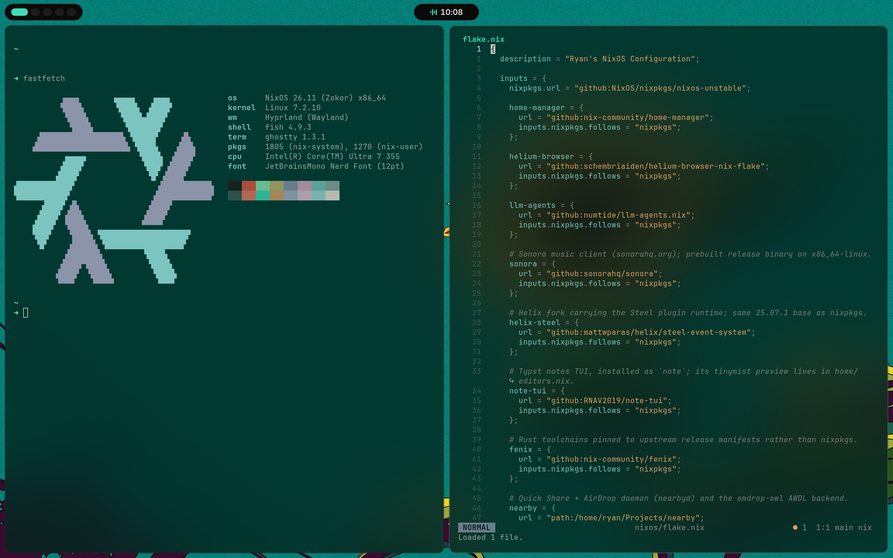<br><sub><b>Ghostty</b> running fastfetch next to <b>Helix</b></sub></td>
    <td>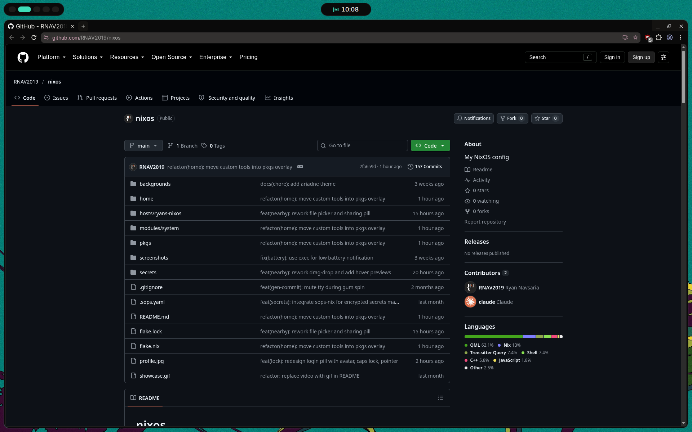<br><sub><b>Helium</b>, themed to match</sub></td>
  </tr>
  <tr>
    <td>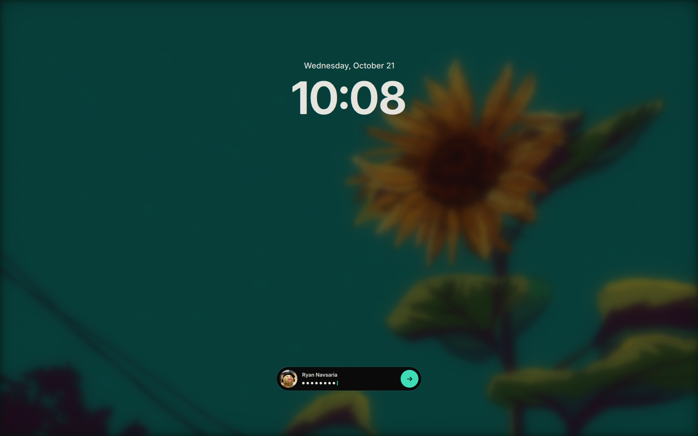<br><sub><b>Lock screen</b> (<code>Super + L</code>)</sub></td>
    <td>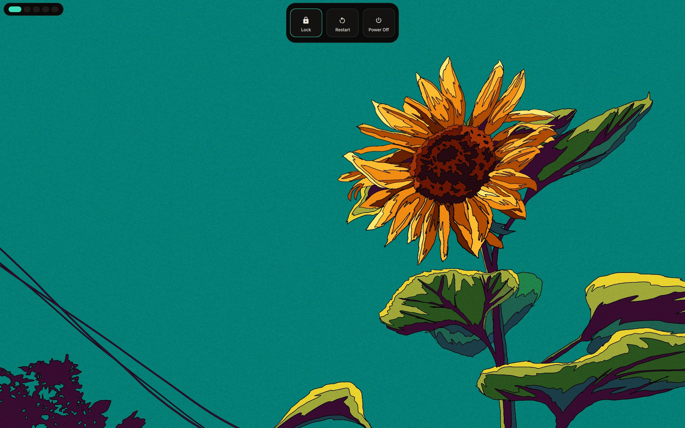<br><sub><b>Session menu</b> (<code>Super + Escape</code>)</sub></td>
  </tr>
</table>

## Stack

| | |
|---|---|
| **OS** | NixOS unstable, flakes, home-manager |
| **Session** | Hyprland (Lua config) on UWSM, greetd autologin, limine and plymouth |
| **Shell UI** | Quickshell: bar, island, every panel, notifications, OSD, lock screen and polkit agent |
| **Wallpaper** | awww |
| **Terminal** | Ghostty, herdr, fish, starship, atuin, zoxide, fzf |
| **Editor** | Helix (Steel plugin fork) |
| **Browser** | Helium, with extensions pinned in Nix and a theme extension per palette |
| **AI** | Claude Code, opencode, T3 Code |
| **Tools** | `gen-commit`, `ical-agenda`, `note-tui`, `backup`, `showcase`, … |
| **Secrets / backups** | sops-nix (age); borg to a NAS over a Cloudflare tunnel |

## Themes

`theme-switch <ariadne|rose-pine|dark>`, or `Alt + T`, swaps one symlink to a generated
theme directory and nudges each running program to pick it up. Palettes are defined in
[`home/themes/palettes.nix`](home/themes/palettes.nix), and every per-program fragment is
generated from them in [`home/theme.nix`](home/theme.nix). New installs start on Ariadne,
and each theme remembers its own last wallpaper.

## Layout

```
.
├── flake.nix             # hosts via mkHost; exports the pkgs/ overlay, packages and checks
├── hosts/<hostname>/     # hardware, stateVersions, monitors
├── modules/system/       # boot, users, secrets, Wi-Fi, backups, shared system config
├── home/                 # home-manager: desktop, shell, terminal, editors, theme, apps
│   ├── quickshell/       # the QML shell, symlinked live from ~/nixos
│   └── themes/           # palettes and per-program theme sources
├── pkgs/                 # own tools as an overlay (pkgs.gen-commit, pkgs.showcase, …)
├── backgrounds/<theme>/  # wallpapers, grouped by theme
├── secrets/              # age-encrypted
└── screenshots/          # generated by `nix run .#showcase`
```

## Installation

> Needs a fresh NixOS install on an Intel machine with a user named `ryan`. Tick disk
> encryption in the installer; the hardware scan below records it.

```bash
# The repo must live at ~/nixos, because quickshell is symlinked from there.
nix-shell -p git --run 'git clone https://github.com/RNAV2019/nixos ~/nixos'
cd ~/nixos

# A new machine gets its own hosts/<name>, which also becomes its hostname.
host=new-laptop
mkdir -p hosts/$host
sudo nixos-generate-config --show-hardware-config > hosts/$host/hardware-configuration.nix
```

For a new machine, write `hosts/$host/default.nix` based on `hosts/ryans-nixos`, keeping
only what is true of the new hardware: the hardware import, both `stateVersion`s, and
optionally `desktop.monitors`. Then add `$host = mkHost "$host";` to `flake.nix` and
`git add hosts/$host`, since flakes only see tracked files.

```bash
# The age key, restored from Bitwarden, is the only thing not in this repo.
sudo install -Dm600 /path/to/age.key /etc/nixos-secrets/age.key

# The first build has to enable flakes itself.
sudo NIX_CONFIG='experimental-features = nix-command flakes' \
  nixos-rebuild switch --flake ~/nixos#$host

# Restore data last, because it needs the secrets the rebuild just decrypted. Then reboot.
backup restore
```

None of the steps above bring back Bluetooth pairings or T3 Code and opencode history.

## Daily use

```bash
rebuild              # build, diff and switch this hostname, with progress on the island (`rebuild build|boot|test|dry`)
nix flake update     # bump inputs
nix flake check      # tool tests and qmlformat
nix-clean            # collect old generations
nix run .#showcase   # regenerate screenshots/ and showcase.webp
```

<details>
<summary><b>Secrets</b></summary>

`secrets/secrets.yaml` is encrypted with [sops-nix](https://github.com/Mic92/sops-nix). It
holds the login password hash, API tokens, the Cloudflare tunnel and Access credentials,
the borg passphrase and SSH key, and the calendar feed addresses. Wi-Fi passwords live in
`secrets/wifi.yaml`, and each network also needs an entry in `modules/system/wifi.nix`.

```bash
sudo edit-secrets             # secrets.yaml in Helix; re-encrypts on save
sudo edit-secrets wifi.yaml   # any other file under secrets/
```

To change the login password:

```bash
sudo -v && umask 077
mkpasswd -m yescrypt | jq -Rs 'rtrimstr("\n")' > /tmp/hash.json
sudo SOPS_AGE_KEY_FILE=/etc/nixos-secrets/age.key \
  sops set --value-stdin secrets/secrets.yaml '["users"]["ryan-hashed-password"]' < /tmp/hash.json
shred -u /tmp/hash.json && sudo chown ryan:users secrets/secrets.yaml
```

</details>

<details>
<summary><b>Phone on the island (KDE Connect)</b></summary>

`programs.kdeconnect.enable` runs the KDE Connect daemon with the session and opens TCP and UDP
1714-1764 for it. The island watches the daemon through [`phone-bridge`](pkgs/phone-bridge)
(`Services/Phone.qml`): a paired, reachable phone is the first circle beside the pill, with its
battery as the ring (love at 20 % or less, a bolt while it charges). Its notifications still arrive
as ordinary toasts, because the daemon sends them to the shell's notification server.

**Pair.** Install KDE Connect on the phone and open it on the same Wi-Fi, then either tap the
laptop in the phone's device list, or run `kdeconnect-cli --list-devices` and
`kdeconnect-cli --device <id> --pair` and accept on the phone. A request made from the phone
grows out of the pill with Accept and Reject. On the phone, allow the plugins you want: Battery,
Notification sync, Clipboard and Find my phone.

**Hover card.** Name and link, battery, the last three phone notifications (click one to dismiss it
on the phone), the text on this computer's clipboard with a button that sends it to the phone,
Ring phone, and Send files, which opens Nearby. KDE Connect gives no way to tell what the phone
sent to the clipboard, so the card shows the clipboard as it is here and never one a password
manager copied.

**Screen preview (optional).** KDE Connect cannot mirror the screen, so the card takes an `adb`
screenshot once a second while it is open, and only when an adb device is connected at the phone's
address. On the phone turn on Developer options, then Wireless debugging; then, once per network:

```bash
adb pair <ip>:<pairing-port>      # the code is on the phone's "Pair device with pairing code" screen
adb connect <ip>:<port>           # the port on the Wireless debugging screen
adb devices                       # the phone is listed as <ip>:<port>
```

Without it the card is the narrower one with no preview. Other adb devices (the TV) are never used.

</details>

<details>
<summary><b>Face unlock</b></summary>

The lock screen can also open with [Howdy](https://github.com/boltgolt/howdy) and the laptop's
IR camera. It is an extra way in, never a replacement: the password field stays live and
focused, and works exactly as before whatever the camera does. The face runs as a second PAM
conversation on its own service, `quickshell-face`. Howdy is on no other service: `login`,
`sudo`, polkit and `quickshell-password` don't know about it
([`modules/system/face-unlock.nix`](modules/system/face-unlock.nix)).

Until a face is enrolled nothing happens: no scan, no ring, no error. To enrol, after a rebuild:

```bash
sudo linux-enable-ir-emitter configure --no-gui   # once; answer the prompts by watching the IR light
sudo howdy add                                    # look at the IR camera; repeat in other light for better odds
```

`--no-gui` matters: without it the tool opens an OpenCV preview window, which a root process
can't put on the Wayland session, so it aborts at the first question. Answer "yes" only once the
IR light visibly flickers (a phone camera shows it). `howdy test` opens the same kind of window
and fails the same way under `sudo`.

The emitter's service (`services.linux-enable-ir-emitter`, device `video2`) re-applies the saved
configuration at boot and after every resume; until `configure` has run it only logs that the
camera is unconfigured.

The lock scans when it appears and again on wake from suspend. **Esc** on an empty field
scans again, up to three misses per lock (a wake starts the count afresh). A face match
unlocks exactly as the password does; typing the first character stops the scan. The IR
camera's path, the certainty (3.0, lower is stricter) and the 5 second timeout are in
`face-unlock.nix`.

To turn it off, either delete the model (`sudo howdy clear`), or remove
`./face-unlock.nix` from the imports in `modules/system/default.nix` and rebuild. Without the
`quickshell-face` service the shell skips the scan silently.

</details>

<details>
<summary><b>Polkit prompts</b></summary>

The shell is the session's polkit agent (`PolkitAgent` in
[`Services/Polkit.qml`](home/quickshell/Services/Polkit.qml), `security.polkit.enable` in
`modules/system/default.nix` only runs `polkitd`). Anything that asks for admin rights through
polkit (`pkexec`, Nautilus' admin actions, fwupd, NetworkManager) grows an
[authentication prompt](home/quickshell/Auth/AuthPrompt.qml) out of the island: who is asking,
polkit's message, the action id (open it for the program and the account that will approve), your
picture and name, and a password field. **Enter** authenticates, **Esc** cancels, **Tab** walks
the plate, the buttons and, with several administrators, an account chooser. A wrong password
shakes the pill and keeps "Sorry, that didn't work" up until the next keystroke. The prompt
holds the keyboard exclusively, goes away on approval, Cancel, polkitd withdrawing the request or
the session locking, and steps aside (then returns) when another panel takes the island.

The Quickshell the flake pins hands over the action id, message and accounts but not polkit's
`details` map, so the program is read back out of the message and the caller isn't shown.

Rehearse every state without a real request: `qs ipc call authpreview ask pkexec` (also `plain`,
`code`, `info`, `identities`, `long`), then `checking`, `fail ""`, `hide`. Polkit allows one agent
per session, so don't start a second shell to test it: `nix build .#checks.x86_64-linux.polkit-agent -L`
runs the real agent against a real `polkitd` and PAM in a VM of its own.

</details>

<details>
<summary><b>Interface sounds</b></summary>

The shell makes a few quiet sounds: a tick on the volume keys, a shutter for screenshots, a pair
for a charger or drive going in, a chime for notifications (a lower one for critical ones), a
bell for timers and Pomodoro phases, a double tap when Claude, a Wi-Fi sign-in or a phone pairing request needs you, a
rising or falling motif for a finished or failed rebuild and drive eject, one for a received
file, and one each for locking and unlocking. They are synthesised at build time with sox
([`pkgs/quickshell-sounds`](pkgs/quickshell-sounds)), never downloaded, and
[`Services/Sounds.qml`](home/quickshell/Services/Sounds.qml) holds the one table that says which
event plays which, played with `pw-play`.

Turn them off in the Control centre under Audio > Interface sounds, or with
`qs ipc call sounds toggle`; the choice is kept in `~/.local/state/shell/sounds`. Peace silences
them too, except the critical-notification sound and a timer's alarm. Nothing sounds for the
first few seconds after the shell starts or reloads.

</details>

<details>
<summary><b>Backups</b></summary>

Borg pushes an archive every day to an append-only server on the NAS, through a Cloudflare
tunnel. If the NAS can't be reached, the run is skipped and the persistent timer catches
up later. The backup covers projects, documents, media folders, `~/.claude`, the Helium
profile, and the atuin and zoxide databases. It leaves out build outputs, virtualenvs and
anything tagged with `CACHEDIR.TAG`.

The job never creates the repository: run `borg init -e repokey-blake2` once by hand, using
`lanSeed` in `modules/system/backups.nix` for the first upload. This client's key can't
prune, so prune on the NAS with the admin key. `backup status` warns once there are 60
archives.

```bash
backup now | status | list [ARCHIVE] | restore [PATH...] | mount [ARCHIVE] | check [--data]
```

</details>

<details>
<summary><b>Showcase</b></summary>

`nix run .#showcase [--shots-only | --webp-only]` regenerates every image in this README, and
gives the same result on every run. It runs inside a nested Hyprland on a hidden workspace,
in a bubblewrap sandbox. That sandbox has a scratch `$HOME`, its own D-Bus and its own
runtime directory, so nothing personal is ever on screen. A made-up calendar, demo Nearby
devices, a silent "now playing" track and a frozen clock fill in for real data. The tour is
scripted in [`pkgs/showcase/showcase.sh`](pkgs/showcase/showcase.sh). The walkthrough is
recorded losslessly and encoded as a full-colour 1920×1200, 30 fps animated WebP, so unlike
a GIF it has no palette banding.

</details>

## Keybinds

| Key | Action | Key | Action |
|---|---|---|---|
| `Super + Return` | Terminal | `Alt + A` | Control centre |
| `Super + Shift + B` | Browser | `Alt + C` | Calendar |
| `Super + Shift + F` | Files | `Alt + N` | Nearby |
| `Super + Space` | Launcher | `Alt + T` | Theme picker |
| `Super + W` | Close window | `Ctrl + Super + Space` | Wallpaper picker |
| `Super + L` | Lock | `Alt + R` | Screen recorder |
| `Super + Escape` | Session menu | `Alt + P` | Power profiles |
| `PrtSc` | Screenshot region | `Super + PrtSc` | Colour picker |
| `Alt + PrtSc` | Screenshot output | `Super + Ctrl + PrtSc` | Screenshot all screens |
| `Alt + S` | Screen tools | | |
| `Super + Scroll` | Zoom the screen, 1× to 4× | `Super + 0` | Reset zoom |
| `Super + Tab` | Overview | hold `Super` | Keybind cheatsheet |

Every capture is saved to `~/Pictures/screenshots`, copied, and shown in a tray that grows out of the island: hover it for Annotate (satty), Copy, Send (Nearby) and Delete, or drag the picture out as a file. `Alt + S` opens the screen tools: region, window and screen grabs, text recognition (tesseract), QR decoding (zbar) and a colour picker with a history. In the tools, `R W S T Q C` pick a tool, `Enter` runs it and `Esc` closes.

**Overview** (`Super + Tab`, a three-finger swipe up, or `qs ipc call overview toggle`): the workspaces pill grows into a card per workspace holding live thumbnails of its windows, captured only while it is open. Typing filters windows by title and app (non-matches dim). `←` `→` and `Tab` walk the windows, `↑` `↓` jump between workspaces, `Enter` focuses the selection and closes, `Shift + ←/→` moves it to the neighbouring workspace, `Ctrl + W` closes it and `Esc` clears the filter, then closes. Drag a window onto another card (or the dashed `New` slot, which takes the lowest empty workspace) to move it there. Each output has its own, opened on the focused one.

**Cheatsheet**: hold `Super` on its own for about 600 ms and every shortcut appears; let go and it goes. Pressing anything else with `Super` (a normal combo, or a mouse drag or scroll) never shows it, and hides it if it is already up. It is generated: the binds in [`home/desktop.nix`](home/desktop.nix) are a described table ([`home/keybinds.nix`](home/keybinds.nix)) that produces both the Hyprland binds and the JSON the sheet reads, so a new bind is listed by giving it a group and a description.

The full list is the cheatsheet (hold `Super`), or [`home/desktop.nix`](home/desktop.nix).

## Touchpad gestures

| Gesture | Action |
|---|---|
| Three fingers, swipe left or right | Switch workspace, following the finger. Stays on the monitor's own workspaces, so workspace 5 remains the external monitor's |
| Three fingers, swipe up | Toggle the Overview |

Workspace switches are instant, with no slide; the swipe just switches. The swipe distance and feel are tuned under `gestures` in [`home/desktop.nix`](home/desktop.nix).
